# Journey Overview

```mermaid
---
config:
  theme: "dark"
  themeVariables:
    commitLabelFontSize: "11px"
    tagLabelFontSize: "10px"
    fontSize: "10px"
  gitGraph:
    mainBranchName: "Self"
    rotateCommitLabel: false
---
gitGraph TB:
    commit id: "Started Journey into the Tech Industry" tag: "2012-12" type: HIGHLIGHT
    branch "Certifications" order: 1
    commit id: "Start: Apple Certified Associate - Mac 10.8" tag: "2013-02"
    checkout "Self"
    merge "Certifications" id: "Done: Apple Certified Associate - Mac 10.8" tag: "2013-02"
    branch "Education" order: 2
    commit id: "Start: B.S. Mobile Dev, Full Sail" tag: "2013-09"
    checkout "Self"
    branch "Volunteering" order: 3
    commit id: "Start: America READS Member, OCPS" tag: "2014-01"
    commit id: "Start: Staff Volunteer, OCPS" tag: "2014-01"
    commit id: "Start: Teach-In Instructor, OCPS" tag: "2014-03"
    checkout "Self"
    merge "Volunteering" id: "Done: Teach-In Instructor, OCPS" tag: "2014-04"
    merge "Volunteering" id: "Done: America READS Member, OCPS" tag: "2015-09"
    checkout "Volunteering"
    commit id: "Volunteer of the Year, OCPS" tag: "2015-09" type: HIGHLIGHT
    checkout "Self"
    merge "Volunteering" id: "Done: Staff Volunteer, OCPS" tag: "2015-09"
    checkout "Self"  
    branch "Projects" order: 4
    commit id: "Start: Toony Cam" tag: "2015-10"
    commit id: "Start: Give Us Strength" tag: "2016-01"
    checkout "Self"
    merge "Projects" id: "Done: Give Us Strength" tag: "2016-01"
    checkout "Projects"
    commit id: "Start: Take Over" tag: "2016-02"
    checkout "Self"
    merge "Projects" id: "Done: Take Over" tag: "2016-02"
    branch "Career" order: 5
    commit id: "Start: Mobile App Dev, Parthenon Studios" tag: "2016-09"
    checkout "Self"
    merge "Education" id: "Done: B.S. Mobile Dev, Full Sail" tag: "2016-11" type: HIGHLIGHT
    merge "Projects" id: "Done: Toony Cam" tag: "2017-06"
    checkout "Career"
    commit id: "Start: Mobile Cross-Platform Dev, Teeps" tag: "2017-07"
    checkout "Projects"
    commit id: "Start: Orlando Health Mobile" tag: "2017-07"
    commit id: "Start: SunRail" tag: "2017-08"
    checkout "Self"
    merge "Projects" id: "Done: Orlando Health Mobile" tag: "2018-01"
    merge "Projects" id: "Done: SunRail" tag: "2018-01"
    merge "Career" id: "Done: Mobile Cross-Platform Dev, Teeps" tag: "2018-01"
    checkout "Career"
    commit id: "Start: Mobile Game Dev, The Fastmind" tag: "2018-02"
    checkout "Projects"
    commit id: "Start: Letter Master" tag: "2018-02"
    checkout "Self"
    merge "Career" id: "Done: Mobile Game Dev, The Fastmind" tag: "2018-04"
    merge "Projects" id: "Done: Letter Master" tag: "2018-04"
    merge "Career" id: "Done: Mobile App Dev, Parthenon Studios" tag: "2018-04"
    checkout "Career"
    commit id: "Start: Engineer 3, Verizon" tag: "2018-04"
    checkout "Projects"
    commit id: "Start: Verizon My Fios" tag: "2018-04"
    commit id: "Start: Verizon Home Network Protection" tag: "2018-06"
    checkout "Self"
    merge "Projects" id: "Done: Verizon Home Network Protection" tag: "2018-08"
    checkout "Certifications"
    commit id: "Start: Apple Certified Associate - Mac 10.13" tag: "2018-09"
    checkout "Self"
    merge "Certifications" id: "Done: Apple Certified Associate - Mac 10.13" tag: "2018-09"
    checkout "Career"
    commit id: "Promoted: Engineer 4, Verizon" tag: "2018-10" type: HIGHLIGHT
    checkout "Projects"
    commit id: "Start: My Verizon" tag: "2019-05"
    checkout "Certifications"
    commit id: "Start: Verizon Scrum Master" tag: "2019-12"
    checkout "Self"
    merge "Certifications" id: "Done: Verizon Scrum Master" tag: "2019-12"
    merge "Projects" id: "Done: Verizon My Fios" tag: "2019-12"
    checkout "Certifications"
    commit id: "Start: Creational Design Patterns in Swift 5" tag: "2020-01"
    checkout "Self"
    merge "Certifications" id: "Done: Creational Design Patterns in Swift 5" tag: "2020-01"
    checkout "Education"
    commit id: "Start: M.S. Software Dev, Boston University" tag: "2020-05"
    commit id: "Start: Grad Cert Software Eng, Boston University" tag: "2020-05"
    checkout "Certifications"
    commit id: "Start: AWS Certified Cloud Practitioner" tag: "2020-05"
    checkout "Self"
    merge "Certifications" id: "Done: AWS Certified Cloud Practitioner" tag: "2020-05"
    checkout "Certifications"
    commit id: "Start: Structural Design Patterns in Swift 5" tag: "2020-05"
    checkout "Self"
    merge "Certifications" id: "Done: Structural Design Patterns in Swift 5" tag: "2020-05"
    checkout "Projects"
    commit id: "Start: Verizon 5G Antenna AR Compass" tag: "2020-06"
    checkout "Career"
    commit id: "Promoted: Senior Engineer, Verizon" tag: "2020-12" type: HIGHLIGHT
    checkout "Projects"
    commit id: "Start: Verizon Digital Assistant (Chatbot)" tag: "2020-12"
    checkout "Self"
    merge "Projects" id: "Done: Verizon 5G Antenna AR Compass" tag: "2020-12"
    merge "Projects" id: "Done: My Verizon" tag: "2020-12"
    merge "Projects" id: "Done: Verizon Digital Assistant (Chatbot)" tag: "2021-11"
    checkout "Career"
    commit id: "Start: Senior Software Engineer, Disney" tag: "2021-11"
    checkout "Projects"
    commit id: "Start: Disney Mural Of Memories" tag: "2022-01"
    commit id: "Start: Disney PhotoPass Lenses" tag: "2022-01"
    checkout "Self"
    merge "Projects" id: "Done: Disney Mural Of Memories" tag: "2022-04"
    merge "Education" id: "Done: M.S. Software Dev, Boston University" tag: "2023-05" type: HIGHLIGHT
    merge "Education" id: "Done: Grad Cert Software Eng, Boston University" tag: "2023-05" type: HIGHLIGHT
    checkout "Certifications"
    commit id: "AWS Certified Cloud Practitioner Expired" tag: "2023-05"
    checkout "Self"
    merge "Career" id: "Done: Senior Software Engineer, Disney" tag: "2023-07"
    merge "Projects" id: "Done: Disney PhotoPass Lenses" tag: "2023-07"
    checkout "Career"
    commit id: "Start: Principal Engineer, Verizon" tag: "2023-07" type: HIGHLIGHT
    checkout "Projects"
    commit id: "Start: 5G Home iOS API Network Stack" tag: "2023-07"
    commit id: "Start: Verizon 5G Home Internet (Self Setup)" tag: "2023-07"
    commit id: "Start: Whole Home WiFi: WiFi Health Check" tag: "2023-08"
    checkout "Self"
    merge "Projects" id: "Done: 5G Home iOS API Network Stack" tag: "2023-09"
    merge "Projects" id: "Done: Whole Home WiFi: WiFi Health Check" tag: "2023-12"
    checkout "Projects"
    commit id: "Start: Verizon 5G Gateway Optimizer" tag: "2024-01"
    checkout "Self"
    merge "Projects" id: "Done: Verizon 5G Gateway Optimizer" tag: "2024-06"
    checkout "Projects"
    commit id: "Start: Verizon Wi-Fi Backup" tag: "2024-07"
    commit id: "Start: Or Swift" tag: "2024-09"
    checkout "Self"
    merge "Projects" id: "Done: Verizon Wi-Fi Backup" tag: "2025-06"
    merge "Career" id: "Done: Principal Engineer, Verizon" tag: "2025-12"
    merge "Projects" id: "Done: Verizon 5G Home Internet (Self Setup)" tag: "2025-12"
    checkout "Certifications"
    commit id: "Start: Swift 5 Essential Training" tag: "2026-01"
    checkout "Self"
    merge "Certifications" id: "Done: Swift 5 Essential Training" tag: "2026-01"
    checkout "Certifications"
    commit id: "Start: Master Swift" tag: "2026-05"
    checkout "Self"
    merge "Certifications" id: "Done: Master Swift" tag: "2026-05"
    checkout "Certifications"
    commit id: "Start: Swift 5: Protocol-Oriented Programming" tag: "2026-05"
    checkout "Self"
    merge "Certifications" id: "Done: Swift 5: Protocol-Oriented Programming" tag: "2026-05"
    checkout "Projects"
    commit id: "Start: Lemonade Server: ROCm for RDNA2" tag: "2026-06"
    checkout "Self"
    merge "Projects" id: "Done: Lemonade Server: ROCm for RDNA2" tag: "2026-06"
    checkout "Certifications"
    commit id: "Start: Agile Software Development" tag: "2026-06"
    checkout "Self"
    merge "Certifications" id: "Done: Agile Software Development" tag: "2026-06"
    checkout "Certifications"
    commit id: "Start: Complete Guide to SwiftUI" tag: "2026-06"
    checkout "Self"
    merge "Certifications" id: "Done: Complete Guide to SwiftUI" tag: "2026-06"
    checkout "Certifications"
    commit id: "Start: Swift 6 Essential Training" tag: "2026-06"
    checkout "Self"
    merge "Certifications" id: "Done: Swift 6 Essential Training" tag: "2026-06"
    merge "Projects" id: "Done: Or Swift" tag: "2026-08"
    checkout "Career"
    commit id: "Start: Software Engineer, Apple Services Eng" tag: "2026-08" type: HIGHLIGHT
    checkout "Self"
    merge "Career" id: "Done: Software Engineer, Apple Services Eng" tag: "2026-10"
    checkout "Education"
    commit id: "Start: GitHub Foundations course, MS Learn" tag: "2026-10"
    checkout "Self"
    merge "Education" id: "Done: GitHub Foundations course, MS Learn" tag: "2026-10"
    checkout "Certifications"
    commit id: "Start: GitHub Foundations Certification, MS Learn" tag: "2026-10"
    checkout "Self"
    merge "Certifications" id: "Done: GitHub Foundations Certification, MS Learn" tag: "2026-10" type: HIGHLIGHT
```



# EVENT STREAM

```text
2012-12 → Started Journey into the Tech Industry

2013-02 → Earned Apple Certified Associate - Mac Integration 10.8

2013-09 → Started B.S. Mobile Development, Full Sail University

2014-01 → Started America READS Program Member, Orange County Public Schools
2014-01 → Started Staff Volunteer, Orange County Public Schools

2014-03 → Started Teach-In Instructor, Orange County Public Schools
2014-04 → Completed Teach-In Instructor, Orange County Public Schools

2015-09 → Completed America READS Program Member, Orange County Public Schools
2015-09 → Completed Staff Volunteer, Orange County Public Schools
2015-09 → Earned Volunteer of the Year, Orange County Public Schools

2015-10 → Started Toony Cam

2016-01 → Started Give Us Strength
2016-01 → Completed Give Us Strength

2016-02 → Started Take Over
2016-02 → Completed Take Over

2016-09 → Started Mobile Application Developer, Parthenon Studios

2016-11 → Completed B.S. Mobile Development, Full Sail University

2017-06 → Completed Toony Cam

2017-07 → Started Mobile Cross-Platform Developer, Teeps
2017-07 → Started Orlando Health Mobile

2017-08 → Started SunRail

2018-01 → Completed Orlando Health Mobile
2018-01 → Completed SunRail
2018-01 → Completed Mobile Cross-Platform Developer, Teeps

2018-02 → Started Mobile Game Developer, The Fastmind
2018-02 → Started Letter Master

2018-04 → Completed Mobile Game Developer, The Fastmind
2018-04 → Completed Letter Master
2018-04 → Completed Mobile Application Developer, Parthenon Studios
2018-04 → Started Engineer 3, Software & Systems Engineering, Verizon
2018-04 → Started Verizon My Fios

2018-06 → Started Verizon Home Network Protection

2018-08 → Completed Verizon Home Network Protection

2018-09 → Earned Apple Certified Associate - Mac Integration 10.13

2018-10 → Promoted to Engineer 4, Software & Systems Engineering, Verizon

2019-05 → Started My Verizon

2019-12 → Earned Verizon Scrum Master
2019-12 → Completed Verizon My Fios

2020-01 → Earned Creational Design Patterns in Swift 5

2020-05 → Started M.S. Software Development, Boston University
2020-05 → Started Graduate Certificate in Software Engineering, Boston University
2020-05 → Earned AWS Certified Cloud Practitioner
2020-05 → Earned Structural Design Patterns in Swift 5

2020-06 → Started Verizon 5G Antenna AR Compass

2020-12 → Promoted to Senior Engineer, Software & Systems Engineering, Verizon
2020-12 → Started Verizon Digital Assistant (Chatbot Services)
2020-12 → Completed Verizon 5G Antenna AR Compass
2020-12 → Completed My Verizon

2021-11 → Completed Verizon Digital Assistant (Chatbot Services)
2021-11 → Started Senior Software Engineer, Disney

2022-01 → Started Disney Mural Of Memories
2022-01 → Started Disney PhotoPass Lenses

2022-04 → Completed Disney Mural Of Memories

2023-05 → Completed M.S. Software Development, Boston University
2023-05 → Completed Graduate Certificate in Software Engineering, Boston University
2023-05 → AWS Certified Cloud Practitioner Expired

2023-07 → Completed Senior Software Engineer, Disney
2023-07 → Completed Disney PhotoPass Lenses
2023-07 → Started Principal Engineer, Verizon
2023-07 → Started Verizon 5G Home (Self Setup) iOS API Network Stack
2023-07 → Started Verizon 5G Home Internet (Self Setup)

2023-08 → Started Verizon Whole Home WiFi: WiFi Health Check

2023-09 → Completed Verizon 5G Home (Self Setup) iOS API Network Stack

2023-12 → Completed Verizon Whole Home WiFi: WiFi Health Check

2024-01 → Started Verizon 5G Gateway Optimizer

2024-06 → Completed Verizon 5G Gateway Optimizer

2024-07 → Started Verizon Wi‑Fi Backup

2024-09 → Started Or Swift

2025-06 → Completed Verizon Wi‑Fi Backup

2025-12 → Completed Principal Engineer, Verizon
2025-12 → Completed Verizon 5G Home Internet (Self Setup)

2026-01 → Earned Swift 5 Essential Training

2026-05 → Earned Master Swift
2026-05 → Earned Swift 5: Protocol-Oriented Programming

2026-06 → Started Lemonade Server: ROCm Support for RDNA2 Models
2026-06 → Completed Lemonade Server: ROCm Support for RDNA2 Models
2026-06 → Earned Agile Software Development
2026-06 → Earned Complete Guide to SwiftUI
2026-06 → Earned Swift 6 Essential Training

2026-08 → Completed Or Swift
2026-08 → Started Software Engineer, Apple Services Engineering

2026-10 → Completed Software Engineer, Apple Services Engineering
2026-10 → Started GitHub Foundations course, Microsoft Learn
2026-10 → Completed GitHub Foundations course, Microsoft Learn
2026-10 → Earned GitHub Foundations Certification, Microsoft Learn
```
